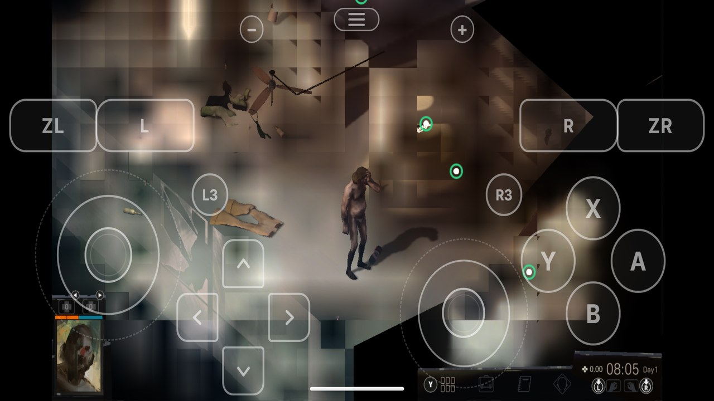
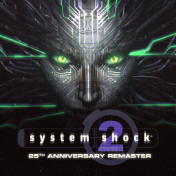

<h1 align="center">
  <picture>
    <source media="(prefers-color-scheme: dark)" srcset="docs/images/logo-dark.svg">
    
  </picture>
</h1>

Port your own Nintendo Switch games to Android, natively: the game's own arm64 code runs on the device, with the Switch's system services stood in for by a host and NVN graphics replayed on Vulkan. Pick the game's folder, click **Port**, and get an APK plus the game's data, installed on your device if you like. Bring your own game files and keys; nothing from any game is in this repository.

This is the Android port of [nxnative](https://github.com/seedds/nxnative), which does the same on iPhone and iPad. Supported games: [Games](#games).

## Games

These games are targeted for Xiaomi Poco F1 (Snapdragon 845, Adreno 630). Hardware BC-compressed texture support is present on Adreno GPUs. Older Adreno 6xx devices bundle a custom Mesa Turnip Vulkan driver to supply Vulkan 1.3 support.

| | |
|:---:|:---:|
|  Blasphemous 2 `poco-f1` · update 1.0.8 · 60 fps |  Hades II `poco-f1` · update 1.0 · 60 fps |
|  Disco Elysium: The Final Cut `poco-f1` · base game 1.0.0 · **experimenting / testing** · Turnip T30 |  System Shock 2: 25th Anniversary Remaster `poco-f1` · update 1.3.0 · **in-testing** · Turnip T30 |

A game that is not in this table is not supported yet. The games we look at next, and the ones done: [docs/PORT_CHECKLIST.md](docs/PORT_CHECKLIST.md).

## For players: port a game without programming

1. Download `nx2android-<version>-windows-x64.zip` (Windows) or `nx2android-<version>-macos-arm64.zip` (Mac with Apple silicon) from [Releases](https://github.com/shirai91/nx2android/releases/latest), unzip it and start **nx2android** (on a Mac, see [packaging/INSTALL.md](packaging/INSTALL.md#1-start-the-app) first).
2. **Setup** tab: click **Download missing tools** (the Android NDK, the .NET SDK and platform-tools, about 1 GB, from Google and Microsoft), then set your **prod.keys**. Every line turns green.
3. **Port** tab: choose the folder with the game's NSP, XCI, NSZ or XCZ files (base game, update, DLC) and click **Port**.
4. Tick **Install on the device when done** with the device plugged in and USB debugging on, or copy the APK and the data folder yourself.

Older Qualcomm Adreno devices: choose an AdrenoTools / Mesa Turnip driver package (`.zip` or `.so`) in the **Vulkan driver** picker on the Port tab (`--driver <file>`). This upgrades older Adreno 6xx devices (such as Snapdragon 845 / Adreno 630 with stock driver 512.502.0) to full Vulkan 1.3 with dynamic rendering and timeline semaphores. If a bundled driver hard-crashes, the app automatically falls back to the system driver on the next launch (or set `DM_VK_SYSTEM_DRIVER=1` in `env.txt` to force the stock driver).

A game played by touch: tick **Touch game** on the Port tab (`--touch`). The on-screen gamepad then starts hidden and every touch but one on the menu button goes to the game; the pause menu shows the gamepad again.

A game that crashes with "AllocateAddressRegion … refused (0x1803)" in its log needs more address space: port it again with a larger **Extra address space** on the Port tab (`--alias-headroom` on the command line). [packaging/INSTALL.md](packaging/INSTALL.md#when-something-goes-wrong) says more.

The step-by-step guide is [packaging/INSTALL.md](packaging/INSTALL.md). You need your own game files and `prod.keys`, dumped from your own Switch; the tool never ships or downloads either. NSZ and XCZ files are decompressed during the port (into the build folder's `tmp/`, deleted once extracted).

## Saves

The game's pause menu (Game tab) has **Export save** and **Import save**: an export is a folder in `Android/data/<package>/files/saves/` on the device, the save's files as a console's save tools copy them, so a save from a console imports the same way. The app's **Saves** tab moves them between the device and the PC.

An import replaces the save the game has; the app exports that one first on the device (a folder ending `-before-import`). Uninstalling the app deletes its saves and its exports: copy them to the PC first.

## For developers

Running from the repository, the command line, the repository layout, building the bundle, tests and commit messages: [docs/DEVELOPMENT_GUIDE.md](docs/DEVELOPMENT_GUIDE.md). How it is put together: [docs/ARCHITECTURE.md](docs/ARCHITECTURE.md).

## Keys and game files

nx2android decrypts your game files with your `prod.keys` while it ports them, as Switch emulators do. This repository and its releases contain no keys, no game files and nothing extracted from them, and the tool never downloads either. Dump both from your own Switch, and don't share them or the APKs and data packs built from them.

Nintendo's takedown notices so far have gone to whoever hosts a project (13 Switch emulator repositories on GitHub in February 2026), not to players. Whether decrypting your own games for your own use is allowed depends on where you live.

## License

MIT, as nxnative (see `nxnative/LICENSE`). Third-party code keeps its own license.
